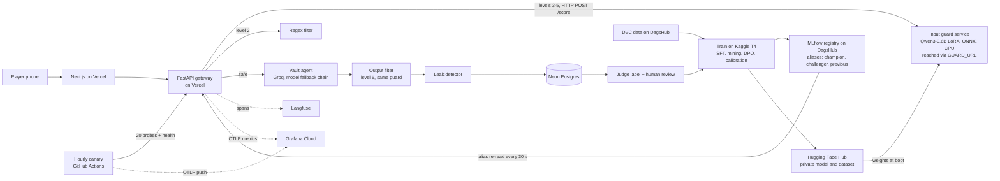

# BreachLab

[](https://github.com/giri-harsh/breachlab/actions/workflows/ci.yml) [](LICENSE) [](DATA_LICENSE.md)

Source: https://github.com/giri-harsh/breachlab (public). The development history lives in the private archive `giri-harsh/Breach-lab`.

A small web game where players try to trick a guarded AI "vault" into leaking a secret code across five levels of increasing defense. The core is a fine-tuned **guard model** (Qwen3-0.6B + LoRA, SFT-only in v1) that classifies every message as safe, injection, jailbreak or exfiltration in a single forward pass. Every successful breach is detected deterministically (the secret appears in the reply), so the game labels its own training data.

> **Research demo.** Not a claim of production safety. Prompts are logged and used to train the guard; do not enter personal data.

Live: web https://breachlab-web.vercel.app, gateway https://breachlab-api.vercel.app (`/api/health`), guard https://breachlab-guard.vercel.app (`/health`; scoring needs a bearer token).

## Status (honest)

| Piece | State |
|---|---|
| Levels 1-2 (system prompt only, keyword wall) | **Live and playable.** No guard model involved. |
| Levels 3-5 (guard, fine-tuned guard, guard plus output filter) | **Live (ADR-0082).** The guard runs as a Vercel Python function (`vercel-guard/`, 1 vCPU, 2 GB) with a 4-bit weight-only ONNX graph. Limits: the single vCPU serializes requests, the first request after about 10 minutes idle takes about 13 s and gets the fail-closed `503 guard waking up` (ADR-0050), and only one graph fits, so level 3 uses the same fine-tuned guard as level 4 (the untuned base guard is not served). A free Hugging Face Space was not possible (402, ADR-0063, ADR-0079). |
| Guard model | Trained, evaluated and exported. Served graph: int4 q4b32 with prefix-KV reuse, SFT-only, with its own decision threshold because it fails the fp32 threshold on false positives (ADR-0082). Weights are in the private Hugging Face repo `Pseudo-Harsh/breachlab-guard-v1`. The guard service contract is host-agnostic (`GUARD_URL`, bearer token); see [`docs/deploy-guard.md`](docs/deploy-guard.md). |
| Latency target (p95 <= 300 ms, CPU) | **NOT met.** Measured on the real Vercel host (warm, concurrency 1, 500 requests): model-time p95 of <!--num:qwen3-0.6b-sft-int4.p95_ms-->3468 ms<!--/num--> (p50 720 ms; round trip p50 842 ms, p95 3556 ms). With four concurrent requests the single vCPU queues them (round trip p50 3664 ms). The first request after a long idle takes about 13 s. The v1 gate runs with a relaxed 4161 ms threshold (measured p95 x 1.2, same metric as ADR-0064), which means "within the relaxed v1 limit", not "meets 300 ms". Earlier Kaggle-emulation numbers (2326 ms) are superseded. A GPU or a faster host is the documented path (`reports/eval-v1.md`). |
| Observability | Hourly canary and weekly drift workflows exist on GitHub Actions but skip (green) until the repository secrets are set (owner action, `docs/blockers.md`). Once set, the canary probes the Vercel guard directly: one cold-start timeout is a warning, a guard that stays down is FAILED (red) (runbook, [`docs/keep-warm.md`](docs/keep-warm.md); the hourly canary does not keep the guard warm). OTLP ingest to Grafana Cloud was proven (HTTP 200) and Langfuse traces work; the dashboard JSON is in `dashboards/` and is imported by hand ([runbook](docs/runbook.md#observability)). No paging by decision (ADR-0025). |
| Repository | Private. Making it (and the Hugging Face repos) public is an irreversible action left to the owner. |

## Architecture



`GUARD_URL` is host-agnostic: the live guard is the Vercel function in `vercel-guard/` (int4 graph, ADR-0082), and any container host that runs `space/Dockerfile` (port 7860, `POST /score`, `GET /health`, contract in `docs/CONTRACTS.md`) can serve it instead. Levels 4 and 5 use the registry `champion`; level 3 is meant to use the untuned `base` alias, but only one graph fits the Vercel host, so there level 3 also gets the champion. If the guard is down or still waking up, levels 3-5 return 503 and never fail open.

Data versioning: DVC on DagsHub. Tracking and registry: MLflow on DagsHub. Training: Kaggle T4 kernels. Decisions: [`docs/decisions.md`](docs/decisions.md). Operations: [`docs/runbook.md`](docs/runbook.md). Retraining loop: [`docs/retraining.md`](docs/retraining.md).

## Headline numbers (gold_test, 1,500 rows, from `reports/eval-v1.md`)

| model | attack success rate (lower is better) | false-positive rate | F1 | AUROC |
|---|---|---|---|---|
| regex filter | <!--num:regex.asr-->59.4%<!--/num--> | <!--num:regex.fpr-->10.3%<!--/num--> | <!--num:regex.f1-->0.531<!--/num--> | <!--num:regex.auroc-->0.652<!--/num--> |
| Llama Prompt-Guard-2-86M (via Groq) | <!--num:llama-prompt-guard-2-86m (Groq).asr-->51.6%<!--/num--> | <!--num:llama-prompt-guard-2-86m (Groq).fpr-->10.3%<!--/num--> | <!--num:llama-prompt-guard-2-86m (Groq).f1-->0.602<!--/num--> | <!--num:llama-prompt-guard-2-86m (Groq).auroc-->0.868<!--/num--> |
| Gemini as judge (zero-shot) | <!--num:gemini-judge.asr-->12.8%<!--/num--> | <!--num:gemini-judge.fpr-->2.8%<!--/num--> | <!--num:gemini-judge.f1-->0.915<!--/num--> | <!--num:gemini-judge.auroc-->0.969<!--/num--> |
| DeBERTa prompt-injection classifier | <!--num:deberta-prompt-injection.asr-->10.4%<!--/num--> | <!--num:deberta-prompt-injection.fpr-->14.2%<!--/num--> | <!--num:deberta-prompt-injection.f1-->0.867<!--/num--> | <!--num:deberta-prompt-injection.auroc-->0.904<!--/num--> |
| Qwen3-0.6B zero-shot | <!--num:qwen3-0.6b-zeroshot.asr-->100.0%<!--/num--> | <!--num:qwen3-0.6b-zeroshot.fpr-->0.4%<!--/num--> | <!--num:qwen3-0.6b-zeroshot.f1-->0.000<!--/num--> | <!--num:qwen3-0.6b-zeroshot.auroc-->0.591<!--/num--> |
| Qwen3-1.7B zero-shot | <!--num:qwen3-1.7b-zeroshot.asr-->61.9%<!--/num--> | <!--num:qwen3-1.7b-zeroshot.fpr-->13.2%<!--/num--> | <!--num:qwen3-1.7b-zeroshot.f1-->0.495<!--/num--> | <!--num:qwen3-1.7b-zeroshot.auroc-->0.777<!--/num--> |
| Qwen3-0.6B fine-tuned, fp32 adapter (reference) | <!--num:qwen3-0.6b-sft.asr-->0.6%<!--/num--> | <!--num:qwen3-0.6b-sft.fpr-->1.6%<!--/num--> | <!--num:qwen3-0.6b-sft.f1-->0.988<!--/num--> | <!--num:qwen3-0.6b-sft.auroc-->0.999<!--/num--> |
| Qwen3-0.6B fine-tuned, int4 graph as served (v1, previous) | <!--num:qwen3-0.6b-sft-int4.asr-->0.6%<!--/num--> | <!--num:qwen3-0.6b-sft-int4.fpr-->2.1%<!--/num--> | <!--num:qwen3-0.6b-sft-int4.f1-->0.985<!--/num--> | <!--num:qwen3-0.6b-sft-int4.auroc-->0.999<!--/num--> |
| **Qwen3-0.6B fine-tuned, int4 graph as served (v2, ships)** | <!--num:qwen3-0.6b-sft-int4-v2.asr-->0.4%<!--/num--> | <!--num:qwen3-0.6b-sft-int4-v2.fpr-->1.8%<!--/num--> | <!--num:qwen3-0.6b-sft-int4-v2.f1-->0.987<!--/num--> | <!--num:qwen3-0.6b-sft-int4-v2.auroc-->1.000<!--/num--> |
| Qwen3-1.7B fine-tuned (comparison, not served) | <!--num:qwen3-1.7b-sft.asr-->0.0%<!--/num--> | <!--num:qwen3-1.7b-sft.fpr-->1.3%<!--/num--> | <!--num:qwen3-1.7b-sft.f1-->0.992<!--/num--> | <!--num:qwen3-1.7b-sft.auroc-->1.000<!--/num--> |

Bootstrap confidence intervals, McNemar tests, slices, the worst misses, the 3-seed table and the size-vs-quality table are in [`reports/eval-v1.md`](reports/eval-v1.md). `scripts/check_readme_numbers.py` fails CI if this table drifts from `web/public/scorecard.json`.

**Read these numbers with care.**
- They are **in-distribution**: `gold_test` shares source datasets and synthetic generators with training (split by parent, near-duplicates checked). The fine-tuned guard has not been evaluated on a fresh, out-of-distribution test set from real players yet.
- Gold labels are generation-time labels, not human labels. A Gemini double-check agrees on 92.7% of the 1,500 rows (Cohen's kappa 0.851); 110 disagreements are queued for human review, which is still pending.
- Three trained seeds (0, 1, 3): SFT ASR 0.49 +- 0.17%, FPR 1.83 +- 0.24%. A fourth run (seed 2) diverged in fp16 and is excluded and disclosed in the report.
- DPO showed no significant gain over SFT-only (McNemar p = 1.0), so SFT-only ships.
- **Short benign openers (fixed in v2, ADR-0094).** On 300 held-out short benign messages (greetings, small talk, questions about the assistant) the v1 guard flagged 54% (Hindi 96%) because the training data had almost no short, Hindi or Hinglish benign text. Guard v2 (v1 + 2,172 hard-benign rows) flags 6.3% [4.0, 9.3] (Hindi 15%, Hinglish 2%, English 2%) with gold ASR 0.44% and FPR 1.83%; the Hindi rate sits at its 15% gate with an 8-22% interval. v1 vs v2 table and caveats: [`reports/eval-v2.md`](reports/eval-v2.md).
- System leak suite (fixed 216 template attacks, vault agent at temperature 0, 95% Wilson CI): level 1 leaked 1 of 210 (0.5%, CI 0.1-2.6%), level 2 0 of 216 (CI 0.0-1.7%), levels 3, 4 and 5 each 0 of 216 (CI 0.0-1.7%). At levels 3-5 the guard blocked all 216 attacks, so the vault and the level-5 output filter were never reached; level 3 and 4 use the same guard graph on this host. A zero here means no leak in this fixed set, not that none exists. **Sanity note: 0% on templated attacks does not mean unbreakable; human players will find gaps.** After guard v2 and the difficulty tuning (ADR-0097, ADR-0100) the numbers that matter are in `docs/lanes/G-difficulty-final.json` and `docs/lanes/H3-difficulty.json` (bosses 4 and 5: 0/216 template and 0/110 fresh attacks on the qwen vault).

## Quickstart

```bash
uv sync --all-groups
uv run ruff check . && uv run mypy && uv run pytest
uv run python scripts/check_readme_numbers.py        # README table vs web/public/scorecard.json
cd web && npm ci && npm run lint && npm run typecheck && npm run build
```

Point the gateway at a guard host: see [`docs/deploy-guard.md`](docs/deploy-guard.md) and the "Pointing GUARD_URL" section of [`docs/runbook.md`](docs/runbook.md).

## Repo map

- `src/breachlab/gateway` game logic, leak detector, guards, FastAPI app, telemetry
- `src/breachlab/train`, `serve`, `eval` training stages, ONNX guard runtime and service, metrics and reports
- `src/breachlab/flywheel`, `monitor` labeling, dataset builds, self-play, registry promote/rollback, canaries, drift
- `web/` Next.js app (play, leaderboard, under the hood, model card, admin review); `dashboards/` Grafana JSON; `vercel-guard/` the live guard function; `space/` guard container image (alternative hosts)
- `docs/` ADRs ([`decisions.md`](docs/decisions.md)), [runbook](docs/runbook.md), [demo script](docs/demo-script.md), blockers, lane reports

## License

Code, model weights and model card: Apache-2.0 (`LICENSE`). Dataset (including share-alike rows from databricks-dolly-15k): CC-BY-SA-3.0 (`DATASET_CARD.md`). The model's training data includes CC-BY-SA-3.0 rows; details and the reasoning are in `DATA_LICENSE.md`.
